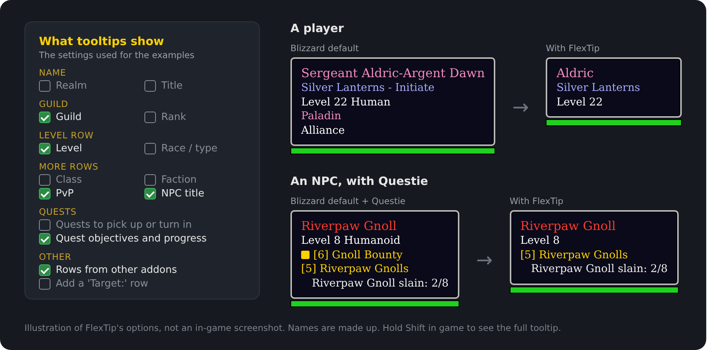

# FlexTip

FlexTip is a World of Warcraft addon for WoW Forever that changes the game tooltip. It can move the tooltip, resize it and collapse it, and it adds a few other tweaks. It is written for the Mainline (Midnight-era) API that WoW Forever uses, so it also runs on retail.



*Illustration of the row options, not an in-game screenshot.*

## Install

1. Close the game.
2. Get the addon: download it from [GitHub](https://github.com/Andremijo/FlexTip) (**Code > Download ZIP**) and unzip it. Rename the `FlexTip-main` folder to `FlexTip`.
3. Copy the `FlexTip` folder into your WoW Forever AddOns folder, usually:
   `World of Warcraft\_forever_\Interface\AddOns\FlexTip`
   During the beta some installs used another folder name, such as `_classic_beta_`. Use whichever `_something_` folder your Forever client runs from.
4. Start the game. On the character screen, open **AddOns** and make sure FlexTip is ticked.

If FlexTip shows as **Out of date**, the client's interface number is different from the one in `FlexTip.toc` (`16001`). To find yours, type this in chat:

```
/dump select(4, GetBuildInfo())
```

Put that number in the `## Interface:` line of `FlexTip.toc`. You can also tick **Load out of date AddOns**.

## Use

| What | How |
|---|---|
| Options window | `/ftip`, the AddOns button on the minimap, or Options > AddOns > FlexTip |
| Move the tooltip | Click **Unlock anchor** (or `/ftip unlock`), then drag the blue box. Right-click it to lock |
| Preview | Click the blue box, or press **Preview** in the options |
| Resize | Scale slider, mouse wheel over the box, or drag the box's corner grip |
| Choose rows | In the **Rows** column, untick the rows to hide (guild, level, class, faction, PvP, NPC title, other) |
| Collapse | Tick **Collapse unit tooltips**, or bind a key under Options > Keybindings > AddOns > FlexTip |
| See everything | Hold Shift (configurable) to show the full tooltip, including hidden rows |

### Settings

- **Position**
  - Where world tooltips (players, NPCs, objects) and UI tooltips (unit frames, action bars) go: the FlexTip anchor, the mouse cursor, or Blizzard's default spot (Edit Mode).
  - Which tooltip corner is pinned to the anchor. The tooltip grows away from that corner.
  - Which corner follows the cursor, and the cursor offsets.
- **Size**
  - Tooltip scale from 0.5x to 2x. Item comparison tooltips get the same scale.
- **Rows** on player and NPC tooltips
  - Show or hide guild, level and race, class, faction, PvP, NPC title (like `<Flight Master>`), quest progress, and other rows (rows from other addons).
  - The name always shows. Hidden rows leave no gaps, because the remaining rows move up.
  - Untick guild, class and faction to get just the name and level.
- **Collapse**
  - How many rows to keep (1 to 6), counting only rows you haven't hidden.
  - Quest progress can stay visible when collapsed without counting toward that limit (on by default).
  - Which key shows the full tooltip while you hold it (Shift, Ctrl, Alt or none). It brings back hidden rows too.
  - Rows added later by other addons are handled too.
- **Appearance**
  - Class-colored names, class-colored border, hide the health bar, background opacity.
- **Target line**
  - Adds a "Target:" line showing who the unit is targeting, with ">> You <<" when it's you. It is off by default; turn it off if another addon already adds one.
- **Combat**
  - Hide tooltips in combat: never, world tooltips only, or all tooltips.

### Chat commands

```
/ftip            open or close options
/ftip unlock     show the draggable anchor (lock hides it)
/ftip reset      move the anchor back to its default spot
/ftip collapse   toggle collapsed unit tooltips
/ftip scale 1.2  set the scale
/ftip preview    show a sample tooltip at the anchor
/ftip resetall   reset every setting
/ftip debug      print errors that FlexTip would otherwise hide
```

## Questie

FlexTip works alongside [Questie](https://github.com/Questie/Questie):

- The quest titles and objectives Questie adds to NPC tooltips count as **Quest progress** rows, not "Other rows". Hiding other rows or collapsing the tooltip keeps them (unless you untick Quest progress).
- This also works inside instances, where Questie shows the game's quest rows in a form addons can't read.
- Questie's wrapped objective rows keep wrapping when FlexTip moves them up.
- Questie's map-icon tooltips follow your cursor as usual; FlexTip doesn't move them.

Without Questie, the game's own quest rows count as Quest progress too.

## Notes

- **Combat restrictions.** WoW Forever uses Midnight's addon rules, so some values are "secret" during restricted combat. When that happens, FlexTip skips the extras it can't read, such as the target line or class colors, and the tooltip itself keeps working. `/ftip debug` shows what was skipped.
- **Edit Mode.** When an anchor setting is "Blizzard default", the tooltip uses the position you set in Edit Mode (HUD Tooltip).
- **Rows and collapse** only apply to unit tooltips (players and NPCs). Item and spell tooltips stay full.
- **Class row:** some tooltips put the class on the level row ("Level 80 Human Paladin"). Then the class can't be hidden on its own; hide the level row instead.
- **Rows FlexTip can't read** (secret during restricted combat) are always shown.

## Development

You can't run the game in CI, so `tests/` has a small mock of the WoW API. The tests in there click through the addon's behavior: anchoring, rows, collapse, the anchor box and the options window. Running them needs Lua 5.1 and [luacheck](https://github.com/lunarmodules/luacheck):

```bash
tests/run.sh
```

The `tests/` folder is never loaded by the game, so it's fine to leave it in your AddOns folder.

## License

FlexTip is released under the [MIT License](LICENSE).
